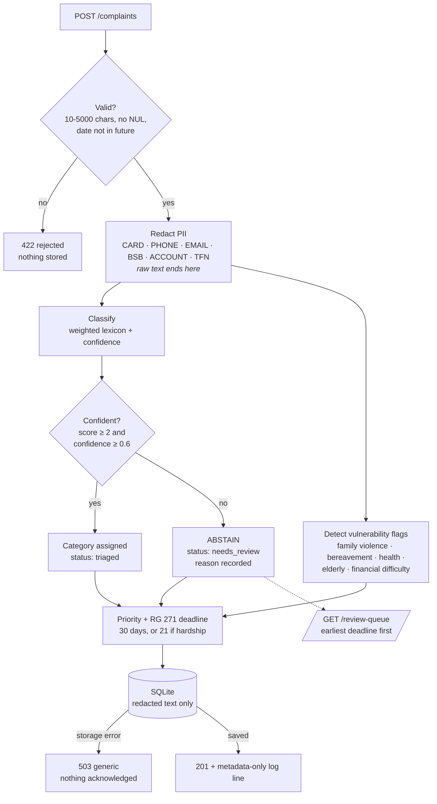
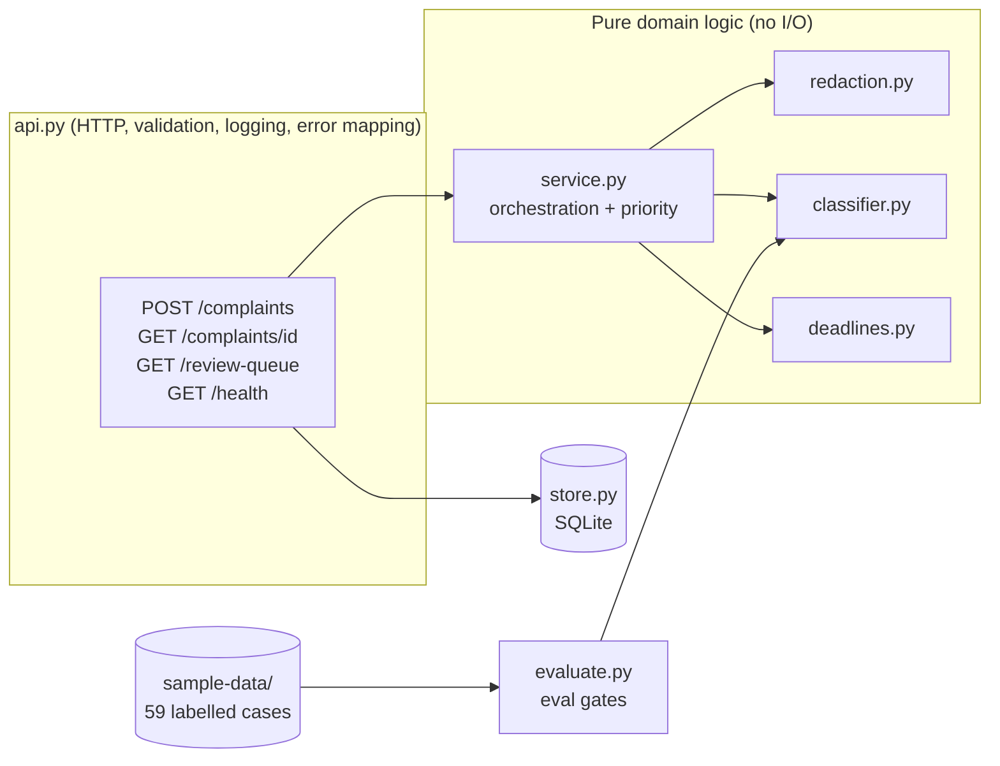
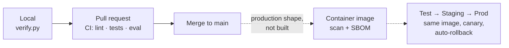

# Complaint Triage Service

A thin vertical slice of a bank complaint-triage service. For each (synthetic) customer complaint it:

1. **validates** the input and rejects anything malformed;
2. **redacts PII** (cards, accounts, BSBs, phones, emails, TFNs) before anything is stored or logged;
3. **classifies** it (scam/fraud, financial hardship, fees, service conduct, product issue) with a
   confidence score and the matched terms that explain why;
4. sets **priority** and the **ASIC RG 271 response deadline** (30 days, or 21 for hardship);
5. **abstains** to a human review queue when the signal is weak or ambiguous, rather than guessing;
6. persists only the redacted record.

Everything runs locally and offline. No API keys, containers, credentials or real data are needed.

> **AI disclosure:** this repository was built with an AI coding agent (Claude Code) as the primary
> implementation tool, with a human directing and reviewing. See
> [`evidence/agentic-workflow.md`](evidence/agentic-workflow.md).

## How it works

### Request flow


### Components


### Delivery path

The dotted part is the intended cloud path, described in [`evidence/operate.md`](evidence/operate.md).
It isn't built in this slice.

## Prerequisites
- Python 3.11 or newer
- git

## Setup
```bash
git clone https://github.com/harshmeet30/complaint-triage-service.git
cd complaint-triage-service
python -m venv .venv
# Windows: .venv\Scripts\activate      macOS/Linux: source .venv/bin/activate
pip install -r requirements.txt
```

## Run
Quick demo, with no server needed (in-memory store, four representative cases):
```bash
python scripts/demo.py
```

The API server:
```bash
# macOS/Linux:  PYTHONPATH=src uvicorn triage.api:app
# Windows (PowerShell):  $env:PYTHONPATH="src"; uvicorn triage.api:app
```
Interactive docs at http://127.0.0.1:8000/docs. Config: `TRIAGE_DB` (default `data/triage.db`),
`LOG_LEVEL` (default `INFO`).

## Verify (what CI runs)
```bash
python scripts/verify.py     # lint + format check + 55 tests with 95% branch-coverage floor + eval gates
```
The same command runs in GitHub Actions on every push and pull request. PRs use
[`.github/pull_request_template.md`](.github/pull_request_template.md).

## Example
```bash
curl -s -X POST http://127.0.0.1:8000/complaints -H "Content-Type: application/json" \
  -d '{"text": "Scam! Unauthorised charge on card 4111 1111 1111 1111. Call me on 0412 345 678.", "received_date": "2026-03-01"}'
```
Response (trimmed):
```json
{
  "status": "triaged",
  "category": "scam_fraud",
  "confidence": 0.857,
  "priority": "high",
  "due_date": "2026-03-31",
  "redacted_text": "Scam! Unauthorised charge on card [CARD]. Call me on [PHONE].",
  "redaction_counts": {"CARD": 1, "PHONE": 1}
}
```
A vague complaint such as *"My husband died last month and I need someone to call me back."* gets
`status: needs_review`, `category: null`, `abstain_reason: no_signal`, `priority: high` (bereavement
flag) and appears in `GET /review-queue`.

| Endpoint | Purpose |
|---|---|
| `POST /complaints` | Triage one complaint (201, or 422 if invalid, or 503 if storage is down) |
| `GET /complaints/{id}` | Fetch a triaged record |
| `GET /review-queue` | Abstained complaints, earliest deadline first |
| `GET /health` | `ok`, or 503 `degraded` if the database is unreachable |

## Known limitations
- **No authentication.** Local use only. Do not expose it (ADR-0014).
- **Keyword classifier.** Explainable and offline, but weaker on unseen phrasing. The eval set shares an
  author with the lexicon, so its 100% accuracy is optimistic (ADR-0011).
- **Names and addresses are not redacted** (needs NER).
- Deadlines count calendar days only (no business-day or holiday calendars). RG 271 handling should be
  confirmed with Compliance.
- English only. SQLite is not the production datastore.

## Evidence pack
[`evidence/`](evidence/): [intent](evidence/intent.md) · [design](evidence/design.md) ·
[agentic workflow](evidence/agentic-workflow.md) · [verify](evidence/verify.md) ·
[operate](evidence/operate.md) · [decisions](evidence/decisions.md) (16 ADRs in `evidence/adr/`)

## Layout
```
src/triage/     redaction.py  classifier.py  deadlines.py  service.py  store.py  api.py  evaluate.py
tests/          unit, API, PII-leak and eval-harness tests
sample-data/    labelled synthetic eval set (59 complaints)
scripts/        verify.py (CI entry point), demo.py
evidence/       intent, design, agentic-workflow, verify, operate, decisions + adr/
```
